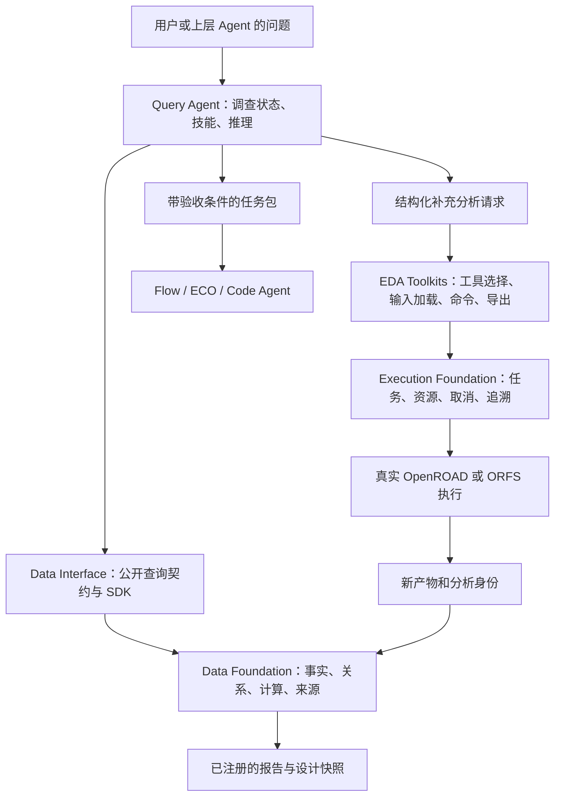

# Query Agent 科研地图与建设方案

日期：2026-10-08。状态：完成首轮专题调研、源码/历史成果核查和设计建议；下述调查工作流、Toolkits 迁移及新 benchmark 尚未实现。本报告区分论文方法、现有软件事实和拟开展研究。

## 1. 我们要交付的结果

用户问“这次为什么变差”，系统应沿当前实验的真实数据开展调查：确认比较对象和变化，关联时序/物理/配置证据，提出可检验的候选原因，选择能区分原因的下一项查询或只读 EDA 分析，给出带来源的判断和仍未解决的问题，必要时向 Flow/ECO/Code Agent 交接。

简单查询可以直接完成；深问题能逐步展开；部分证据已充分时先回答该部分。缺少根因证据时，不能只停在“不支持”：还应报告已经查清的事实、未排除的假设以及哪项补充分析能推进调查。

Data Foundation 已有扎实的查询积累，详见 [核查报告](PROJECT_AUDIT_20261008.md)。本阶段优先继承、接通、复测这些能力，不从零建一套同义数据库、STA 或 OpenDB 解析器。

## 2. 调研方法与阅读深度

围绕五个问题展开检索：数据获取质量、诊断 harness、自适应问题分层、按需原生分析、可验收的 Agent handoff。以用户规划书中的代表工作及现有历史科研地图为种子，扩展到其参考文献、相关论文、作者仓库和官方文档；去掉仅有营销介绍或与 ASIC 物理设计任务无直接联系的候选。

只以论文、作者项目或官方文档支撑技术判断。最新获取日期为 2026-10-08。阅读等级：A＝阅读全文中相关方法/实验/限制；B＝阅读作者摘要或仓库 README；C＝官方工程文档。没有安装或运行外部研究项目，因此“代码可找到”不等于“本机已能复现”。这是专题研究地图，不宣称覆盖全部文献。

### 2.1 设计事实、文本证据与领域知识

| 来源与阅读等级 | 能借鉴什么 | 取舍与复用位置 |
|---|---|---|
| [CircuitOps，ICCAD 2023；作者仓库](https://github.com/NVlabs/CircuitOps)（B） | 共享中间表示、实体/属性/连接关系分开，服务多个下游 | Data Foundation 延续结构化事实及关系查询；不因论文使用图表示就立即引入重型图数据库。作者仓库为 Apache-2.0；具体组件仍需固定版本验证。 |
| [OpenDB 官方文档](https://openroad.readthedocs.io/en/latest/main/src/odb/README.html)、[OpenSTA 作者仓库](https://github.com/parallaxsw/OpenSTA)（C/B） | 使用原生物理数据库与 STA 能力，保持对象身份和分析条件 | 直接复用现有 native bridge 和原生 API；Query Agent 不重新解释 ODB 或自行算 STA。工具加载/命令进入 Toolkits。 |
| [EDATracer，arXiv:2608.04032v1](https://arxiv.org/html/2608.04032v1)（A） | 带 provenance 的 artifact 图＋语义检索；检索与推理迭代协作 | 对日志、脚本、报告文本借鉴；精确数值与物理连接仍走 DF。其当前范围主要是综合 artifact，物理设计阶段是未来扩展，不能照搬为我们的诊断成品。图构建质量和预处理成本是明确限制；本轮未确认可直接复用的公开实现仓库。 |
| [ORAssistant 作者仓库](https://github.com/The-OpenROAD-Project/ORAssistant)、[论文](https://arxiv.org/abs/2410.03845)（B） | OpenROAD 文档检索、命令知识与安装/调试问答 | 作为版本化领域知识适配的参考；工具文档不能作为当前 run 的事实证据。仓库标注 GPL-3.0，直接整合代码前要确定发行方式。 |
| [ChipNeMo，arXiv:2311.00176](https://arxiv.org/abs/2311.00176)、[EDA Corpus，arXiv:2405.06676](https://arxiv.org/abs/2405.06676)（B） | 领域知识、脚本与芯片设计语料的价值 | 可用于术语/知识/脚本测试候选；不能用训练知识补出当前实验的缺失数值。暂不以训练专用大模型为前置条件。 |

选择：结构化事实查询、源文件检索、领域文档检索三者合作。嵌入相似度可以帮助找解释线索，但不负责确认 snapshot、corner、单位、对象身份或全量计数。

### 2.2 深度分层、调查循环与检索质量

| 来源与阅读等级 | 能借鉴什么 | 取舍与复用位置 |
|---|---|---|
| [ReAct，arXiv:2210.03629](https://arxiv.org/abs/2210.03629)（B） | 将推理和工具反馈交替，后续行动依赖新证据 | 用于深问题的调查循环；每一轮保留可观察的假设、查询理由和结果，而不要求展示模型内部思维链。 |
| [Adaptive-RAG，arXiv:2403.14403v2](https://arxiv.org/html/2403.14403v2)、[作者代码](https://github.com/AsH1605/Adaptive-RAG)（A/B） | 依据问题选择不同检索深度，减少所有任务都走复杂流程的成本 | 借鉴路由框架；其开放域问答分类器不直接适合 EDA，也不能采用“无检索凭模型记忆”回答实验数值。必须评测错分，尤其是深问题被分到浅流程。 |
| [CRAG，arXiv:2401.15884](https://arxiv.org/abs/2401.15884)、[作者代码](https://github.com/HuskyInSalt/CRAG)（B） | 检查检索质量，再纠正检索或选择其他来源 | 借鉴证据质量评估；私有设计数据缺失应查原始产物或补 EDA 分析，不能靠网页检索填补。论文训练组件不直接成为当前模型的接口。 |
| [Self-RAG，arXiv:2310.11511](https://arxiv.org/abs/2310.11511)（B） | 根据需求检索、评估证据与生成支持关系 | 借鉴检查问题；其反思 token/训练方案不是任意模型上追加几句 prompt 就能等价实现。 |
| [LLMCompiler，arXiv:2312.04511v3](https://arxiv.org/abs/2312.04511v3)（B） | 有依赖的查询计划，独立调用可批量/并行执行 | 用于 A/B 指标、配置、同 scope 的互不依赖读取；对象解析、候选筛选和依赖查询保持正确顺序。无需先引入整套编译器。 |

选择：先确定语义和证据范围，浅问题用固定查询，深问题用反馈驱动的循环。路由标签只是初始预算选择，调查中能升级，也能在事实已够时提前结束。

### 2.3 Harness、skills 与可恢复工作流

| 来源与阅读等级 | 能借鉴什么 | 取舍与复用位置 |
|---|---|---|
| [PDAgent-Bench，arXiv:2606.17253v6](https://arxiv.org/html/2606.17253v6)（A） | 物理设计专家技能包、阶段上下文、预算层次与真实工具评测 | 优先借鉴 debug 决策表、跨阶段影响与技能模板；其多数实验环境含商业工具，不能直接当作我们 OpenROAD 的验收。论文的技能效果不是我们自己的效果。 |
| [Anthropic：有效的 Agent](https://www.anthropic.com/engineering/building-effective-agents)（C） | 路由、固定 workflow、动态调查和评价循环的适用边界 | 选择最有助于任务的组合；不按 Agent 数量评价成熟度。 |
| [Anthropic：Context Engineering](https://www.anthropic.com/engineering/effective-context-engineering-for-ai-agents)（C） | 按需获取高信号上下文、压缩、外部状态和过程记忆 | 每轮只加载必要技能与证据；持久化调查状态避免靠模型记忆维持 scope。压缩不能丢单位、coverage 和反证。 |
| [Agent Skills 规范](https://agentskills.io/specification)、[技能工程说明](https://www.anthropic.com/engineering/equipping-agents-for-the-real-world-with-agent-skills)（C） | 可发现、逐步加载、可携带脚本和参考资源的技能包 | 优先使用可跨模型宿主的技能格式；Query 技能以诊断步骤为主，工具可执行脚本在 Toolkit 中独立维护。 |
| [LangGraph 官方文档](https://docs.langchain.com/oss/python/langgraph/overview)（C） | 长任务的状态、checkpoint 和流程编排 | 对恢复/异步等待有价值，作为候选做小型集成比较；领域模型仍归 QA，EDA 进程仍由 EF 管理。现有代码无框架不代表永远不允许采用成熟框架。 |
| [DSPy 作者仓库](https://github.com/stanfordnlp/dspy)（B） | 以数据集和指标优化 LM 程序/提示 | 先建立可验收数据和基线，再比较自动 prompt 优化；封存测试集不得参与优化。不是先堆 prompt、最后寻找成功例子。 |
| [OpenAI：Agent workflow evals](https://developers.openai.com/api/docs/guides/agent-evals)、[技能评测](https://developers.openai.com/blog/eval-skills)（C） | 记录真实轨迹/产物，评估工具选择、交接与回归 | 使用本地可重放 trace 和确定性检查。无需为了评测引入额外在线产品或控制台。 |

选择：一个主推理模型配合确定性数据操作、可选窄判断模型和版本化技能。直接由 Codex 作为主推理器的运行模式应优先保留，不默认在 Codex 之后再调用一次相同级别模型。独立运行模式再实现真正的模型 adapter，两种模式使用同一份状态/工具/评测契约。

### 2.4 工具反馈、任务交接与闭环评测

| 来源与阅读等级 | 能借鉴什么 | 取舍与复用位置 |
|---|---|---|
| [ORFS 作者仓库](https://github.com/The-OpenROAD-Project/OpenROAD-flow-scripts)、[Hammer 作者仓库](https://github.com/ucb-bar/hammer)（B） | 已有流程、阶段、工艺/工具适配边界 | Toolkits 包装现有 OpenROAD/ORFS 能力。借鉴 Hammer 的技术/工具分离，不重建后端流程或要求直接部署整个 Hammer。 |
| [ORFS-agent 作者仓库](https://github.com/ABKGroup/ORFS-Agent)、[AgenticPD，最新 v3](https://arxiv.org/abs/2607.04758v3)（B） | 真实反馈驱动配置优化、阶段历史与中间状态复用 | 后续 Flow 接口参考。Query 交接目标、约束和变化证据，不自己偷偷修改 recipe。 |
| [ResizerAgent 作者仓库](https://github.com/ASU-VDA-Lab/ResizerAgent)、[EvoDRC](https://arxiv.org/abs/2607.20019)（B） | timing/局部 DRC 修复的对象范围、反馈与副作用验证 | ECO 交接参考。对方可改什么、必须检查哪些副作用写入任务包；这些闭环没有证明我们的 Query 诊断能力。 |
| [AuDoPEDA](https://arxiv.org/abs/2601.06268)、[GR-Evolve](https://arxiv.org/abs/2604.22234)、[ReviewDSE](https://arxiv.org/abs/2607.11294)（B） | 开源工具源码优化与保护评价机制 | Code 交接携带最小复现、版本、允许源码范围和 evaluator；失败首先排查输入、环境和工具使用，不能直接归咎于算法。 |
| [Handoff Perspective，arXiv:2606.19795v1](https://arxiv.org/html/2606.19795v1)（A） | 以消费者接受条件、交接对象和有效性界定边界 | 交接有效性应由接收方验证，不以自然语言总结看起来合理作为成功。该综述检索截至 2026-05，不能当作涵盖后来全部方法的最新清单。 |
| [CLOSER-Bench，arXiv:2607.16632](https://arxiv.org/abs/2607.16632)（B） | 按预算衡量跨阶段进展、工具成本与失败恢复 | 借鉴闭环评测指标。其初期 pilot 很小，不能引用为成熟通用优越性证明。 |
| [OpenADA 作者仓库](https://github.com/simra-tech/OpenADA)（B） | 对外 Agent–EDA contract 和能力就绪程度的声明 | 接口契约参考；README 区分 discovery 与稳定 operation，OpenROAD 本体能力仍有未就绪部分，不作为现成后端替代品。 |

## 3. 四项目与 Toolkits 怎样合作

| 责任 | 归属 | 不应散到哪里 |
|---|---|---|
| 哪次实验、哪个快照、来源对应什么事实、缺哪些字段 | Data Foundation | SDK 或每个 Agent 各自猜 |
| 完整候选域上的统计、join、排序、单位与物理语义 | Data Foundation | 让模型读前 10 行推全量结论 |
| HTTP/SDK、工具 schema、错误/分页、稳定响应语义 | Data Interface | 存库、研究策略、重复聚合 |
| 工具路径/版本、库与 SDC/SPEF 加载、Tcl 调用、专用导出 | Toolkits | 通用执行内核或 Query prompts |
| 调度/进程、资源、取消/失败、输入输出、哈希/追溯 | Execution Foundation | Agent 临时 shell 脚本 |
| 用户问题、假设、技能、证据需求、分析理由和交接 | Query Agent | DF 被迫回答为什么 |

层之间依赖公共包或 HTTP，保留四套独立开发环境。Toolkits 是独立适配项目，初期只发布 OpenROAD/ORFS；EF 当前的工具插件和 DF 当前的工具调用通过迁移验收后归入其中。工具专有解析进入 adapter，统一事实语义及跨记录计算留 DF，不能把所有解析和所有计算笼统搬到一侧。

规划书曾假设企业数据底座支持。现在先用已有后端验证公共数据契约；以后企业实现作为数据 provider 接入，不把未知的企业能力当成本轮已交付的事实。

## 4. 难点一：提高输入数据质量和获取效率

### 4.1 三条检索路径

1. 事实与关系：实例、pin、net、时序路径、区域、指标、完整计数，走 DF 的索引和确定性计算。
2. 实验来源：输入/配置/约束差异、日志、工具收据、版本与运行状态，走 EF 注册来源和 DF 元数据。
3. 领域知识：版本对应的工具文档、专家调试方法、已验证案例，走知识 provider；始终与当前设计事实分开。

先按 design/revision/run/stage/snapshot 与分析上下文限域，再找相关内容。语义检索适合错误描述和解释线索，不应替代精确 net 名称、bus index、pin 身份或数字计算。

### 4.2 继承文档二最有价值的语义

- Timing occurrence 是路径上的一次观察；同一 pin 多次出现仍保留不同上下文。
- Net/instance 是快照内物理对象；工程统计按对应对象去重，不能重复数面积或 net。
- 路径上候选 net 可以是局部集合，但 fanout 必须计算完整 native net 的所有有效 load，不能只数路径上 load。
- 排名/聚合在完整声明域上计算，然后选择返回细节。分页少并不等于计算域小；stored sample 不等于全设计最坏路径。
- 不完整映射、缺字段、显示截断、剩余分页是独立维度。结果必须告诉模型其能够支持什么判断。
- snapshot-local ID 不能直接作为跨阶段身份。新增/删除对象、名称候选、已验证对应和歧义都要保留。
- 分析 snapshot 只能在设计、阶段和数据库 digest 等条件一致时复用父物理事实；新 STA 仍拥有独立 analysis identity。

这些能力大部分已有代码，当前优先做正式版本的完整 HTTP/SDK/QA 接入和大设计回归，而非再造一套概念类似的 ContextPack。

### 4.3 面向模型的证据包

建议 EvidencePack 包含：精确 scope、analysis/corner/check/unit、问题所需事实、计算域和计算依据、对象关系、coverage/unmapped/missing/continuation、原始来源 identity＋digest＋定位、版本与查询摘要、冲突/反证、可展开入口。

默认返回高信号摘要、排名和精确来源；模型按需展开记录和原文。对路径查询显式取有界 full evidence，不能把快照层去重的来源随意配给某一条路径。大文件能否实际取回也要验收，存在一个引用并不等于引用已经验证。

缓存键必须包含快照/分析、query 语义、field/coverage 和工具/解析版本。一次新补分析要形成新身份；不能跨 SDC/SPEF/Liberty 条件复用旧答案。大量补分析优先引用相同父物理事实，测量重复存储与 DB 增长后再决定数据层优化。

## 5. 难点二：有思考能力的 Harness

### 5.1 工作流与状态

建议应用层负责一个可 checkpoint 的 InvestigationState：原问题、目标与预算、已选 scope、已确认事实、候选假设/反证、证据需求及满足情况、执行过的查询、等待中的分析 run、当前结论、下一步和停止原因。

固定事实路径保留现有确定性规划；复杂路径由真实推理器提议下一步查询和假设，代码核对 scope、能力、输入和预算后执行。新结果改变调查状态。不要继续把 `DiagnosisProvider` 设计成凭空返回真实根因的黑箱，也不要把“存在 findings fixture”当成诊断实现。

LLM adapter 必须实际消费原问题、当前状态、技能和工具说明。现有 `LLMQueryPlanner` 丢弃 request、仅收到 intent 的接点需要替换；prompt 文件必须真正进入运行时，并记录版本及使用证据。

### 5.2 第一批专家技能

| Skill | 调查要点 | 必需验证 |
|---|---|---|
| timing_regression | 约束/clock/corner/RC 一致性；相同 endpoint 与路径组成；cell/net delay、slew/load/fanout；setup/hold 副作用 | 区分最差路径换人和同对象退化；缺寄生时不能把线延迟归因当成结论 |
| congestion_regression | utilization、macro 通道、pin density、层级可用资源、route 估计与真实 route | 区分区域关联和因果；验证候选域/网格覆盖 |
| power_regression | internal/switching/leakage、活动率、频率/电压、Liberty 与状态差异 | 无活动/工况时只给已有估计与限制，不能宣称 signoff 功耗 |
| tool_failure | 输入/库/版本/命令条件、首个有效错误、后续级联症状 | 有效工具失败与无效实验分开；退出码 0 不保证 EDA 分析成功 |
| experiment_comparison | 输入差异、共同分析语义、阶段变化、对象对应与来源 | 不混 stage/corner/unit；不同约束的两次运行可展示变化，但不能归因为同条件优化 |
| handoff | 已确认问题、未排除原因、允许动作、接收方结果和评价 | 引用可取回、scope 未过期、后续 Agent 接收或明确拒绝 |

每个 skill 附触发条件、证据要求、调查步骤、常见误判、成功/失败示例、停止条件及自己的评测题。技能不是把所有文档塞进一段 prompt；按问题加载，脚本调用复用 Toolkit。

### 5.3 假设与结论的纪律

每个假设记录 supporting/contradicting evidence、已排除原因、仍缺的判别条件和下一项检验。结论区分“已观察事实”“由定义计算的变化”“证据支持的解释”“待验证假设”。空间相关、时间先后或 slack 变差单独都不足以确认因果。

下一项分析应能区分候选原因。例如：缺详细 timing path 先查同 endpoint path；怀疑约束变化先取 SDC/clock 差异；有 path 但缺 RC 条件再检查寄生或用同输入补 STA。不要默认每次都重跑全流程。

停止条件：已经满足回答目标；预算耗尽；所需工具/输入不可用；多轮没有新增可判别证据；或问题需要转交允许修改的后续 Agent。停止时仍输出调查进展和具体缺口，不能伪造“原因已确认”。

## 6. 难点三：问题深度与 JEV

### 6.1 深度、证据充分性、动作类型分别判断

| 维度 | 例子 | 机制 |
|---|---|---|
| 意图/深度 | 查询数值、固定比较、因果调查、请求修复 | 模型语义判断；用主推理器或可选 JEV |
| 证据是否存在且有效 | 唯一快照？单位明确？路径覆盖完整？来源 digest 相符？ | 代码与 DF 确定性状态 |
| 允许采取哪些动作 | 已批准的只读分析预算、是否涉及设计修改 | 应用策略与已有授权；模型概率不提供权限 |

深度建议为 L0 直接事实、L1 固定组合/比较、L2 渐进调查；另有 manual_review 表示信息需求无法辨认。不是“短问题简单、长问题复杂”。“这次为什么变差”虽短仍需调查。缺 snapshot 的 WNS 问题是 scope 待解决，不等于推理深问题。

路线可以升级：L0 发现冲突后进入调查，L2 经查询发现唯一明确原因后结束。routing 应根据当前 evidence state 更新；初始标签不能锁死整个流程。

### 6.2 JEV 适用边界

已阅读 [JEV 官方介绍](https://docs.typesafe.ai/introduction)、[confidence 说明](https://docs.typesafe.ai/confidence)、[已知限制](https://docs.typesafe.ai/model-jaggedness/jev-1.13)。JEV 面向 typed choices/scores/probabilities；其官方限制明确将数字精度和多层间接推理列为短板。

可评测的用法：意图/深度分类、从明确 skill 候选中选择、证据段相关性、提供证据对某一句 claim 的支持关系。保持问题窄、state 小、可退回主推理器。不能拿它计算 slack/fanout、验证 SHA、决定跨阶段对象等价、确认科学因果或生成分析脚本。

概率/置信度是模型输出，不是事实证明，也不是自动执行授权。保留完整分布，固定模型版本；按本地验证集测量混淆矩阵、复杂问题错分率、自动覆盖率、校准、延迟和成本后确定阈值。候选顺序/表达变化也需要稳定性检查。

本次使用 [JEV Decision 技能](/home/wjyuan/.codex/plugins/cache/personal/jev-decision/0.1.0+codex.20260928112458/skills/jev-decision/SKILL.md) 准备了 16 道中英文分层示例，gold 在调用前固定。实际 `jev_classify` 返回 `fetch failed`，没有获得分类、model、usage 或 cost，因此不能报告准确率或成本，也没有将 JEV 接入正式 QA。

试验输入和原始失败见 `var/research/20261008/jev-routing-fixture.json`、`jev-routing-result.json`。16 题仅用于接口 smoke；后续采用独立标注、封存的真实题库，对比规则路由、主模型路由、JEV 和无路由工作流。只有总任务质量/成本获益才保留 JEV 组件；服务不可用时可按原有主推理模式继续。

## 7. 难点四：缺数据时补充真实 EDA 分析

分析请求不只是 Tcl 字符串。建议明确：request identity、来源 snapshot/run、输入 artifact identities/hashes、需要验证的问题、所选 capability/endpoint/corner/check、库/SDC/SPEF 与版本、预期输出、资源和时间预算、去重键、父子关联、结果需要怎样回到调查。

执行链：QA 提出有目的的 AnalysisRequest → Toolkit 解析能力和加载输入 → EF 创建新 run 并管理进程/取消/日志 → 成功后 DF 导入新分析事实 → DI 按相同语义返回 → QA 继续查证。工具失败、缺库、未约束路径、缺寄生、输出不完整都保留具体原因。

先做定向 STA，再扩展功耗/拥塞/其他 native query。优先复用 DF 当前的 timing/native 代码和 OpenROAD report adapter，将工具细节移出数据服务。不要同时保留两套任务构造而让问题再次分散。

分析默认使用已登记的冻结输入和独立工作区，结果不覆盖原设计。只读指不改原设计，不代表零资源成本。调用者可以一次设定允许的分析能力和总预算；授权范围内连续执行，不要求每一轮重复确认。需要新范围或无法确定对象时才澄清。

功耗答案的可信度受活动率、频率、电压、库和寄生条件约束。OpenROAD 的功耗估计与商业 signoff 不是同一验收目标，初期按可复核的分析条件回答。

## 8. 难点五：交给 Flow / ECO / Code Agent

### 8.1 交接对象

HandoffPackage 至少包含：任务及父调查 identity、目标和成功条件、固定 design/revision/run/snapshot/stage、工具/工艺/输入摘要、已确认事实和可取回证据、支持/反证与未确认假设、建议接收角色及理由、允许动作/对象/源码范围、禁改输入、预算、必须返回的实验/产物/评价。

| 接收者 | Query 交付什么 | 对方必须返回什么 |
|---|---|---|
| Flow Agent | 全局/阶段退化证据、可调整 recipe/参数范围、关键约束 | 新配置、真实 run、下游 timing/PPA/DRC/runtime 与基线对比 |
| ECO Agent | 确定快照中的候选 net/cell/region、局部问题、允许修改范围 | 修改清单和新状态；setup/hold、面积/功耗、连通性与其他副作用验证 |
| Code Agent | 最小复现、工具版本、算法相关证据、允许源码范围和 protected evaluator | patch、构建版本、实际执行证据、合法性/完整 flow/QoR/runtime 结果 |

角色建议允许 unknown 或返回继续查证。全局退化不一定需要 Flow，局部 net 问题不一定能 ECO，工具输出异常更不一定需要改源代码。

### 8.2 接收与回收

接收方校验 schema、scope、来源是否可取回、输入是否齐、对象是否有效、动作空间是否足够；返回 accepted 或具体拒绝原因。不因 JEV 高分或一段漂亮摘要就自动接收。

新实验仍由 EF 运行，DF 产生新快照。后续 Query 在新旧正确 scope 上复核结果与副作用，闭合交接。首先用契约型接收器验收交接，再逐个接真实 Flow/ECO/Code，不能把 mock 接收当成后续 Agent 已实现。

## 9. 用一个真实问题贯穿设计

问题：“同一个设计这次 routing 后 WNS 明显变差，下一步该改 flow 还是做 ECO？”

1. 明确 A/B 实验、routing snapshot、setup/hold、corner、clock、单位和输入条件。范围不唯一就返回候选，不静默选最新。
2. 读取全局指标、约束/库/版本差异、关键 endpoint 分布与跨阶段变化。不能把两次各自最差 path 当成同一 path。
3. 按同 endpoint/明确对应对象比较 cell/net delay、slew、load、fanout 和区域事实，保留完整计算域与证据。
4. 建立约束变化、cell/修复操作、RC/拥塞等候选原因，明确支持、反证和不足。
5. 缺定向详细路径时，用原输入提交只读 STA；仅在原数据无效或需要验证其他因素时才扩大分析。
6. 返回能确认的部分和剩余不确定性；有依据时推荐 Flow 或 ECO，并形成可验收任务包。

这条链路是下一阶段验收目标，不是当前代码已经具备的成功案例。

## 10. 怎么证明值得用

### 10.1 公平基线与消融

至少比较：A Codex＋原始文件/原生工具；B Codex＋预先写好的优秀脚本/索引/可复用 loader；C Codex＋DF/DI；D Codex＋完整 Query harness；E 在 D 上加可选 JEV。工具、原数据、模型设置、预算和可获得证据一致，轮次顺序交替，保留所有失败。

对直接组允许脚本复用和持久 native session；分开报告 cold start、准备/导入、热查询和维护成本。补分析次数以及原生工具时间要纳入成本，不能只报模型在线秒数。

在 D 中分别去掉作用域/关联、紧凑可恢复交付、技能、动态路由、补分析、证据核验和结构化交接，观察哪些组件真正贡献。历史 72 题实验主要支撑数据能力 bundle；新 QA 必须通过 C 对 D 的增量比较证明自己的价值。

### 10.2 数据集与 gold

继承文档二的三设计/72 题及独立原生 gold；先验证当前版本结果语义，再重新跑模型对照。增加至少 30 个诊断/缺数据任务作为初始规划，覆盖约束改变、RC 缺失/变化、endpoint 路径切换、cell 修复副作用、scope 歧义、数据缺失、工具失败和没有唯一根因的情况。

加入受控变化和真实运行，建立可检验的根因/非根因参考；不能由同一解析器同时生成答案和 gold。开发集与封存集按设计和退化机制拆分，避免模板换个名字就算未知任务。对初期小样本报告区间和不确定性，据结果扩样；不预先保证普遍降本或提速。

### 10.3 验收维度

| 维度 | 要检查的实际行为 |
|---|---|
| 事实正确 | 数值/单位/身份/全量计数/排序与原生 gold 一致 |
| 证据质量 | 结论支持率、反证处理、引用确实可取回；scope/corner 不混 |
| 诊断作用 | 有效根因或正确候选集合、能否排除错误原因，错误因果断言率 |
| 缺数据处置 | 明确缺什么；下一项分析是否有判别价值；获得证据后能否继续 |
| 自适应 | 深问题错分、简单问题不必要步骤、升级/停止是否合理 |
| 补分析 | 真执行、真实失败/取消、输入条件可复现、结果正确导入 |
| 交接 | 接收方能直接执行/评价，过期或不完整任务包被明确拒绝 |
| 效率 | 成功任务的总 wall time、tokens、工具开销、人工介入和恢复成本 |
| 适配 | 新模型/新 Agent/新用户使用契约无需改业务源码；同服务器用户独立状态 |

已知无数据/歧义/单位缺失测试集合中必须避免假成功，同时不能靠把全部诊断题都拒答获得漂亮可靠率。必须同时报告可回答任务完成率、正确拒答率和调查推进率。

## 11. 分阶段交付与验收

| 里程碑 | 工程交付 | 业务验收；不满足则继续迭代 |
|---|---|---|
| M0 历史基础复核 | 能力/代码/数据/benchmark 对照；模块清理清单 | 本报告已完成文件与汇总核查；原生 gold 全量重判和独立版本回归尚待完成 |
| M1 数据能力正式接通 | 关系/fanout/位置/区域/路径增量/跨阶段能力通过 DI 接 QA；可恢复证据 | 三个历史大设计的代表组合问题跑通；缺数据和覆盖限制仍准确；优秀直接脚本基线同时准备 |
| M2 OpenROAD/ORFS Toolkit 与安装 | 迁移工具专用调用；doctor、版本配置、独立用户状态；完整小 flow | 不依赖作者个人路径的新目录安装；真实 flow 和定向 STA 成功/失败/取消/结果入库可追溯 |
| M3 真正的调查 harness | 主推理 adapter、技能、假设/反证、状态/预算/停止及 trace | 至少一组真实 timing 退化问题完成“查证→需要时补分析→有来源结论”；C/D 对照衡量增量 |
| M4 自适应与 JEV 候选 | 独立分层数据集、主模型/JEV/规则/无路由对照 | 任务质量和总成本有可测价值才启用 JEV；网络失败不伪造分类结果 |
| M5 交接与广泛复测 | 类型任务包/接收验证、真实后续 Agent 接点、更多诊断设计 | 接收方能依据包继续工作，返回真实实验并由 Query 复核；不能把 fixture 成功当闭环成功 |

项目发布仍需补齐仓库获取/安装入口、工具配置、公共发行许可、cold-start 验收和实际新用户复现。当前正式开发区不能宣称“GitHub clone 即可完整跑通”。安装工作与上述研究能力并行推进，不能在发布包装上停住专项推理研究。

## 12. 值得研究的四条主线

1. 关联与信息保留：在可核验的前提下，完整候选域计算＋可恢复交付能降低多少模型工作量，哪些缺失关系最影响诊断？
2. 状态依赖的调查深度：把问题意图和证据状态分开后，能否在维持诊断质量时减少无效查询与昂贵推理？JEV 是候选组件。
3. 按判别价值补分析：相同工具预算下，定向新分析能否比固定查询/完整重跑更有效地排除错误根因？
4. 可验收 handoff：接收方检查与结构化来源是否减少重复调查、无效执行和跨阶段失效？

这些是拟验证的研究问题。经典检索、ReAct 和几个模块连线本身不自动构成新贡献；研究贡献要来自明确的 EDA 难题、方法选择、消融和可复现结果。

## 13. 本轮实际产物

- 两份 PDF 已提取并阅读；规划目标与历史完成报告分别核查。
- 四项目源码和历史工作树对照；历史数据模块没有丢失，工具专用逻辑与 QA 接入缺口已定位。
- 7 模型/1,008 episodes/496 完整成本对及 4 条消融汇总重新计算；原始汇总文件哈希记录在 audit JSON。
- 旧示例 README 的已删除执行入口已修正，没有修改执行/数据运行行为。
- JEV 分层输入和实际网络失败原始记录已保留，没有新 JEV benchmark 成绩。
- 当前设计方案与分阶段验收已经落盘。新诊断 harness、Toolkit 独立项目、完整 flow、新对照和真实 handoff 都是下一阶段工作。

调研采用 OpenAI Docs 与 JEV Decision 技能；外部资料只作为方法和证据来源，不覆盖用户当前的职责、工具范围和轻量部署要求。
