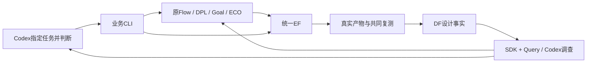

# 单机业务入口

Codex 指定设计、能力、预算和上一份结果；入口准备输入、调用原专业程序，再完成统一复测、数据入库和查询。部署文件登记本机镜像、环境及设计资产。入口没有后台服务、模型规划循环或新的评分体系。

```bash
./chip-evolve.py --config /absolute/path/local.json run --design gcd --capability orfs --key reference
./chip-evolve.py --config /absolute/path/local.json run --design gcd --capability flow --key flow --source /absolute/path/reference/result.json
./chip-evolve.py --config /absolute/path/local.json run --design gcd --capability dpl --key dpl --source /absolute/path/flow/result.json
./chip-evolve.py --config /absolute/path/local.json run --design gcd --capability goal --key goal --source /absolute/path/dpl/result.json
./chip-evolve.py --config /absolute/path/local.json run --design gcd --capability eco --key eco --source /absolute/path/goal/result.json
./chip-evolve.py --config /absolute/path/local.json status --design gcd
./chip-evolve.py --config /absolute/path/local.json diagnose --result /absolute/path/candidate/result.json --against /absolute/path/reference/result.json
./chip-evolve.py --config /absolute/path/local.json select --result /absolute/path/candidate/result.json --reason 'Codex给出采用理由'
```

这些是可选能力的调用示例。Codex 应根据事实选择顺序、是否继续及是否采用结果。默认 Flow 为两轮、12 个候选；DPL 为一轮、三个 Student；Goal 保留原四 Student；ECO 默认一轮且每轮做路由校准。参数可显式设置。`--seconds` 是本次专业运行预算；准备、Query 与最终数据交付的耗时也保留在实验记录中。

| 文件 | 职责 |
|---|---|
| config.py / cli.py | 部署绑定、业务请求、状态及结果入口 |
| jobs.py | 公共 EF 提交、任务回执、产物取回与受监管命令 |
| physical.py | 原 ORFS 基线、完整路由校准、共同测量及 DF 入库 |
| clock.py | 将 OpenSTA 的明确 ps 约束绑定到原 Flow 时钟变量；保留匹配虚拟时钟和其他约束 |
| professional.py | 原 Flow / DPL 控制器、真实 placement→CTS 交接及候选配置恢复 |
| native.py | 原 Goal / ECO 控制器与其输入准备；DEF 保留原数据库精度 |
| diagnosis.py | 已有 Query 的 Codex hosted 调查、引用证据与专业上下文导出 |
| selection.py | 保存 Codex 的采用理由、核查明确硬约束、保留合法 incumbent |
| comparisons.py | 同方法复测及同条件事实差值；不生成新的综合得分 |

专业算法及评分仍属于各独立项目。所有 EDA、构建和官方检查器由 EF 监管；数据查询使用安装的 SDK 和 DF/Query 公共接口。`result.json` 记录共同条件下的最终事实，`native_method` 和专业原回执记录原生筛选，二者要分别解读。Goal 的四项原结构检查不等于完整逻辑等价证明。



历史运行只读。每次运行必须用新 key；只恢复已成功的计算证据，不覆盖历史失败。`collect-flow` 可以补完已成功原生 Flow 的数据交付；它不会重跑布局布线。`--operation replay --code-source` 可在新运行中构建并重放已保存的 DPL 源码，原分数和筛选规则保留。

统一收尾和验证入口：

```bash
./chip-evolve.py --config /absolute/path/local.json resume --design aes --key original-experiment
./chip-evolve.py --config /absolute/path/local.json compare --result /absolute/path/candidate/result.json --against /absolute/path/reference/result.json
./chip-evolve.py --config /absolute/path/local.json validate --result /absolute/path/candidate/result.json --against /absolute/path/reference/result.json --key qualification
./chip-evolve.py --config /absolute/path/local.json continue-goal --result /absolute/path/goal/result.json --context /absolute/path/professional-context.json --key next-round --seconds 21600
```

`resume` 重接 ORFS 已提交任务、补完已结束 Flow 的交付，或从 DPL/Goal/ECO 保存的成功交付检查点继续 CTS/route/测量/入库。不重启尚未完成的专业模型搜索。恢复保留原失败状态副本，并拒绝改变输入内容；同一实验的活跃业务驱动持有本机锁，不能同时恢复。

`validate` 返回共同条件差值、固定 Liberty 下的数字逻辑输出证明、独立目录阶段重放和 DF/SDK 事实核查。相同 key 可继续未完成的验证，原 EF 任务使用相同身份；不同验证的子任务身份互不冲突。成功返回 0，已完成但指标不一致或约束未满足返回 2；工具/证明失败保留原回执。ORFS 从 RTL 重新执行，DPL 从原布局继续 CTS/route，Goal/ECO 从原专业 checkpoint 完整 DRT/RCX；不宣称重新做了模型搜索或源码演化。是否采用仍由 Codex 调用 `select` 并给出理由。

证明只在 EF 解析 JSON 已确认没有端口连接时，排除 TAPCELL/FILLER/DECAP 物理单元和 scope 元数据；实际网表不改动。隐藏内部名称避免把等价换脚误判为不等价，保留顶层端口一致、原 Liberty、顺序归纳和断言。完整输入 hash、模型排除证据和日志可查。

`continue-goal` 适用于已达到原功耗目标的 Goal 源码父项：在新实验继承原目标、规则和四 Student，继续原生时序恢复。它是新的有预算续作，区别于不重做专业搜索的 `resume`。

当前注册验证覆盖 ASAP7 的 GCD 与 AES 标准单元设计。新设计需要登记真实 RTL/原设计配置、SDC、库、top、原生 case 与路由层；不宣称未经验证的 PDK、存储宏或不同周期的多时钟设计已支持。

有限本机对照使用部署 client Python 的 `python -m chip_evolve.comparisons`，提供 `compare`、`replay-goal`、`verify-logic` 三个命令，具体参数可用 `--help` 查看。它们保留固定方法、真实失败与原评分，只返回可复查事实；Codex仍决定是否采用。实测和限制见 `admin/LOCAL_PROFESSIONAL_COMPARISON_REPORT_20261014.md`。
