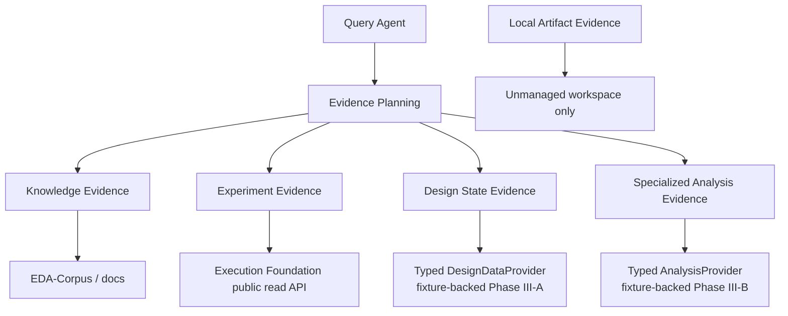
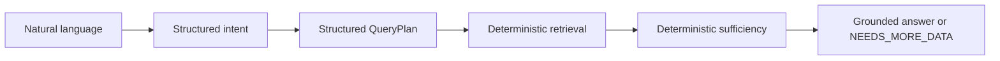
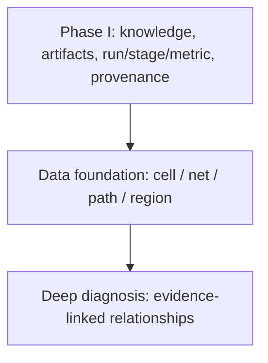

# Query Agent architecture

## Phase II experiment context layer

For managed-run questions, the application can resolve a typed experiment
context before collecting evidence:

```text
QueryRequest -> Intent + QueryPlan
            -> ExperimentContextProvider
            -> run/stage selection + freshness + conflict + comparison policies
            -> ResolvedExperimentContext -> EvidenceCollector
```

`ExperimentContextProvider` exposes run, stage, artifact, metric, and
provenance views. The execution-foundation adapter translates only its public
HTTP API. Domain and application code do not import foundation internals or
open its database. Selection reason codes, rejected candidates, freshness
assessments, and unresolved conflicts are retained in `QueryTrace`.

An explicit run wins. Latest-valid requires a successful run and requested
stage. Current never reuses an older run while the newest run is active or
failed. Comparisons require aligned design, canonical stage, metric, unit, and
corner semantics. Partial artifact lineage remains partial rather than an
authoritative conflict.

## Provider map



`LocalArtifactProvider` is deliberately separate from the execution-foundation
adapter. Managed runs are read through the foundation's public API; the local
provider cannot scan an attempt workspace.

## Query pipeline



## Progressive capability boundary



## Boundary

The Query Agent is a read-mostly application layer over typed ports:

```text
interfaces
    -> application (parse, plan, collect, evaluate, respond)
        -> domain (typed requests, plans, evidence, responses)
        -> ports
            <- adapters (local artifacts, future corpus/data/execution)
```

`domain` has no knowledge of filesystems, databases, HTTP clients, or model
SDKs. `application` receives providers by dependency injection. Adapters are
the only place that knows how a provider is reached.

## Phase III-A design-object boundary

Design understanding is a typed read-only port, not a parser hidden in the
query service:

```text
QueryService -> DesignDataProvider
             -> get_instance / get_net / get_pin
             -> get_connections / get_fanout / get_location
             -> get_instances_in_region
```

The domain vocabulary contains only stable identities, locations, regions,
instances, nets, pins, and connections. It deliberately does not model an
ODB/DEF object graph. `FixtureDesignDataProvider` is a deterministic contract
implementation for tests and demos; a real data-foundation adapter can replace
it without changing planning or answerability. Missing objects and unavailable
capabilities remain `NEEDS_MORE_DATA`, while every returned object is cited by
its typed locator and source hash when one is available.

## Phase III-B analysis boundary

Timing understanding is a separate typed port:

```text
QueryService -> AnalysisProvider
             -> get_timing_metrics (WNS / TNS)
             -> get_timing_paths (bounded, optional slack threshold)
```

`TimingMetricObservation` and `TimingPathObservation` carry an explicit
design/run/stage/corner scope and analysis provenance. The application converts
them to cited evidence and refuses partial or unavailable results. The fixture
adapter is deterministic; a production adapter must use an authoritative
read-only service and must not add shell execution or timing-graph parsing.

## Phase I pipeline

1. Validate `QueryRequest` and its small `QueryContext`.
2. Parse a `QueryIntent`; intent does not imply answerability.
3. Build a `QueryPlan` containing explicit evidence requirements and
   capabilities.
4. Collect typed `Evidence` through read-only providers.
5. Evaluate coverage using deterministic code.
6. Return `ANSWERED`, `PARTIAL`, `NEEDS_MORE_DATA`, `UNSUPPORTED`, or `FAILED`
   with citations and next steps.

`ROOT_CAUSE` is a legal intent, but it requires evidence and capabilities that
Phase I may not have. The correct result is then `NEEDS_MORE_DATA`, never a
plausible explanation generated from experience.

## Provider boundaries

- `KnowledgeProvider` returns cited domain/tool knowledge.
- `ArtifactProvider` lists and searches a bounded workspace and has no write or
  shell API.
- `DesignDataProvider` has deterministic fixture and unavailable adapters; no
  DEF/SPEF/ODB parser is hidden behind either boundary.
- `RunEvidenceProvider` reads existing registered run/stage/metric/artifact/log
  and provenance evidence through a public service API. It never creates a
  task. Managed runs must use this provider and must not be scanned as local
  workspaces.
- `AnalysisProvider` is a bounded Phase III-B port for registered read-only
  timing evidence. Its fixture adapter is deterministic; a production adapter
  still requires an authoritative analysis service.
- `LanguageModel` accepts and returns Pydantic models. Any concrete SDK must be
  isolated under `adapters/llm/` and invalid structured output must raise
  `LLMContractError`.

The local artifact adapter rejects traversal, symlink escapes, binary text
reads, and unbounded reads. It resolves every path beneath its configured
workspace root and exposes metadata for binary files instead of their bytes.

## Deliberate non-goals

There is no agent graph framework, arbitrary shell execution, autonomous
execution, deep timing/congestion/DRC analysis, flow optimization, ECO, or
cross-run causal inference in this phase.
