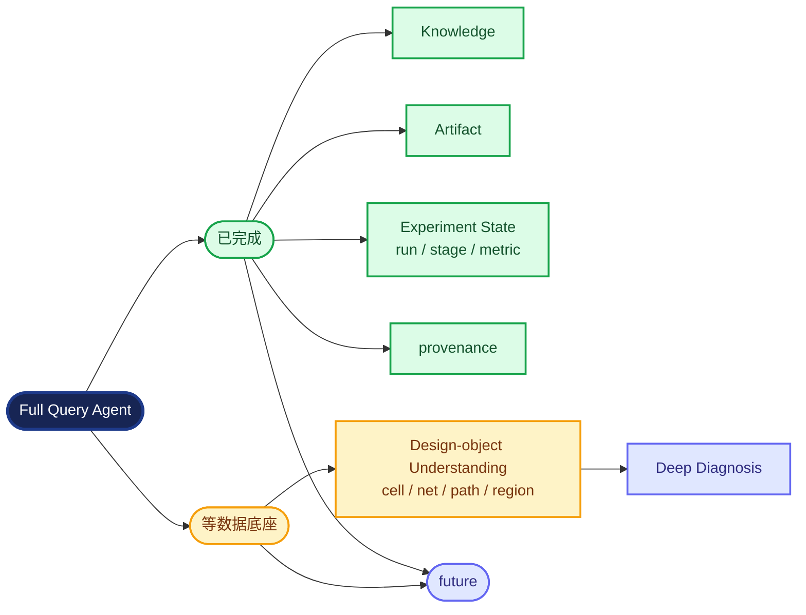

# Overnight Query Agent report

## Executive result

Phase I is ready for morning review. The vertical slice can classify a natural
language question, create an explicit evidence plan, collect scoped evidence,
reject stale/conflicting/wrong-scope facts, and return citations or
`NEEDS_MORE_DATA`.

## Current progress

```text
                      Full Query Agent
                            │
       ┌────────────────────┴───────────────────┐
       │                                        │
   已完成                                   等数据底座
       │                                        │
   Knowledge                         Design-object Understanding
   Artifact                          cell / net / path / region
   Experiment State                         │
   run/stage/metric                         ▼
   provenance                         Deep Diagnosis
       │                                        │
       └──────────────────► future ◄────────────┘
```



## Phase I capability table

| Area | Status | Evidence source |
| --- | --- | --- |
| Knowledge | supported | EDA-Corpus QA and prompt-script rows |
| Artifacts | supported | local unmanaged workspace or registered run artifacts |
| Experiment state | supported | execution-foundation public read API |
| Provenance | supported | locator, hash, scope, provider, trace |
| Design-object understanding | unavailable | future data foundation |
| Deep diagnosis | unavailable | requires design relations and paths |

## Benchmark summary

- Tests: **43** collected and passing (deterministic, no network dependency).
- Benchmark: **30/30** cases passed (**100%**).
- Benchmark categories cover knowledge, artifacts, metrics, status, logs,
  cross-run comparison, wrong run/stage, conflicts, stale evidence, missing
  sources, unsupported object queries, and root-cause insufficiency.
- Real LLM calls are optional and are not a CI requirement; the typed fake
  model covers schema and contract behavior.

## Providers implemented

- `EDACorpusKnowledgeProvider`: lexical, local, reproducible CSV retrieval.
- `LocalArtifactProvider`: bounded read-only unmanaged workspace access.
- `ExecutionFoundationRunEvidenceAdapter`: public GET-only managed-run evidence.
- `UnavailableDesignDataProvider`: explicit unavailable boundary.
- `FakeLanguageModel`: deterministic typed LLM edge for tests.

## Demo commands

```bash
# A: metric query against a managed run API
query-agent ask "What is the routing WNS for run_02?" \
  --kernel-url http://127.0.0.1:8000 --design gcd --run run_02 --stage routing

# Or use the included bounded local timing artifact
query-agent ask "WNS" --workspace tests/fixtures/sample_workspace --stage routing

# B: root-cause query reports NEEDS_MORE_DATA when relations are absent
query-agent ask "Why did timing become worse?" \
  --kernel-url http://127.0.0.1:8000 --design gcd --run run_02 --stage routing

# C: knowledge query against a local EDA-Corpus checkout
query-agent ask "What is global routing?" \
  --workspace tests/fixtures/sample_workspace \
  --eda-corpus /path/to/EDA-Corpus

query-agent benchmark benchmarks/phase1
```

The included demo script uses the repository's bounded read-only fixture for
A/B and uses `--eda-corpus` only when a real checkout is supplied.

## Architecture deviations

None from the repository rules. The only external integration is through the
`KnowledgeProvider` and `RunEvidenceProvider` ports. The EDA-Corpus checkout is
not copied into this repository and no execution-foundation database or
attempt workspace is opened.

## Technical debt

1. Lexical corpus retrieval is intentionally simple; ranking and dataset
   refresh policies will need a contract before any heavier index is added.
2. The CLI's managed-run demo needs a running public API endpoint.
3. Design-object and deep-diagnosis capabilities remain explicit gaps.

## Next three tasks

1. Specify the design-data evidence contract with the future data foundation.
2. Add a read-only analysis request path for bounded, registered diagnostics.
3. Expand knowledge-source indexing only after retrieval quality has a
   deterministic evaluation set.

**P0 completed:** yes  
**P1 completed:** yes  
**P2 completed:** knowledge provider yes; design-object/deep-diagnosis no

## READY FOR MORNING REVIEW
